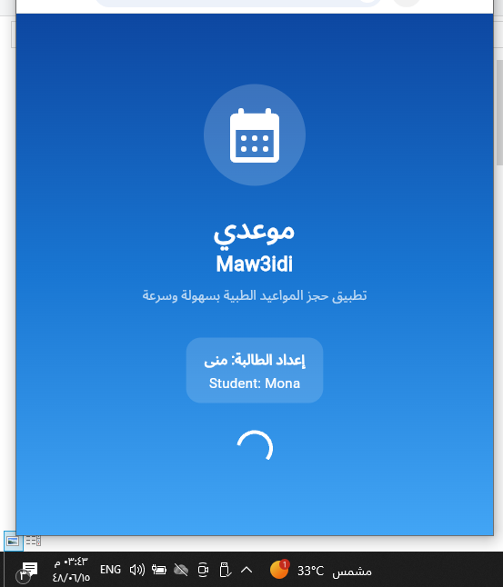
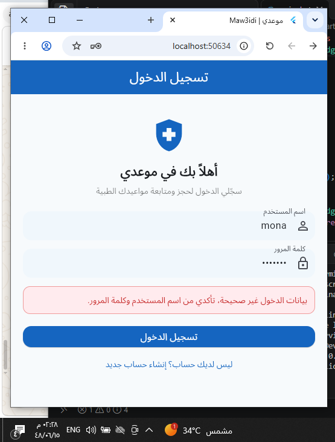
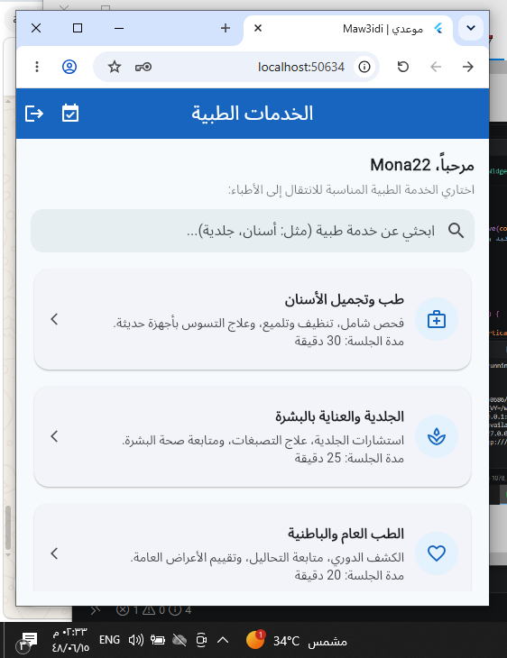
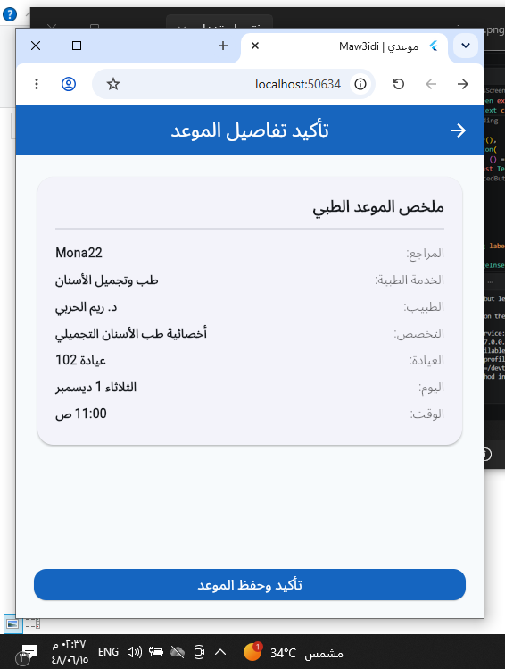

# موعدي (Maw3idi)

**إعداد:** منى

## فكرة التطبيق
تطبيق **موعدي (Maw3idi)** هو تطبيق مطوّر باستخدام **Flutter** لإدارة وحجز المواعيد بواجهة عربية تدعم الاتجاه من اليمين إلى اليسار (**RTL**) مع إمكانية تشغيله واستعراضه على المتصفح.

## قائمة الشاشات والتنقل بينها
* **شاشة البداية (`splash.png`):** تعرض هوية التطبيق وتهيئ المستخدم للدخول.
* **شاشة تسجيل الدخول (`login.png`):** تتيح تسجيل الدخول وإدارة الجلسة، مع إظهار رسائل تنبيه/خطأ واضحة في حال إدخال بيانات غير صحيحة أو ناقصة.
* **الشاشة الرئيسية (`home.png`):** تعرض المواعيد والبيانات الأساسية وتتيح التصفح والتنقل بسهولة بين أقسام التطبيق.
* **شاشة تأكيد الموعد (`confirm.png`):** تتيح مراجعة تفاصيل الموعد وتأكيد إتمامه أو العودة لتعديل البيانات.

يتم التنقل بين الشاشات بسلاسة عبر الأزرار وعناصر الواجهة التفاعلية وتمرير البيانات بين الشاشات حسب خطوات المستخدم.

## الميزة الإضافية وطريقة عملها
* **الميزة الإضافية:** رسالة تأكيد قبل الحذف.
* **طريقة عملها:** عند ضغط المستخدم على خيار حذف موعد، تظهر نافذة أو رسالة تأكيد تسأله للتأكيد قبل تنفيذ الحذف؛ إذا ضغط تأكيد يتم حذف الموعد من القائمة، وإذا ضغط إلغاء يبقى الموعد كما هو دون حذف.

## صور من التطبيق (Screenshots)

## فيديو شرح تشغيل التطبيق
يمكن مشاهدة فيديو استعراض تشغيل التطبيق كاملًا من الشاشة الافتتاحية عبر Google Drive:
[مشاهدة فيديو المشروع على Google Drive](https://drive.google.com/file/d/1bbJSUUlYHy18ae2MzC6xV32Qh8ytVHkT/view?usp=sharing)

---

# Maw3idi

**Prepared by:** Mona

## App Idea
**Maw3idi** is a **Flutter** appointment management application featuring an Arabic interface with right-to-left (**RTL**) support and web browser compatibility.

## Screens & Navigation Flow
* **Splash Screen (`splash.png`):** Introduces the app identity and leads into the main flow.
* **Login Screen (`login.png`):** Handles sign-in and displays feedback/error messages for invalid or incomplete inputs.
* **Home Screen (`home.png`):** Displays appointments/items and allows navigating across the app views.
* **Confirm Appointment Screen (`confirm.png`):** Lets users review appointment details and confirm or go back to adjust selections.

Users move across screens via interactive controls and navigation actions while passing relevant state/data between views.

## Additional Feature & How It Works
* **Additional Feature:** Confirmation dialog before deletion.
* **How It Works:** When the user taps delete on an appointment, a confirmation prompt appears before removing it; confirming deletes the appointment, while canceling keeps it intact.

## Screenshots

## Demo Video
Watch the full app walkthrough from the initial screen on Google Drive:
[Watch Maw3idi Demo on Google Drive](https://drive.google.com/file/d/1bbJSUUlYHy18ae2MzC6xV32Qh8ytVHkT/view?usp=sharing)
